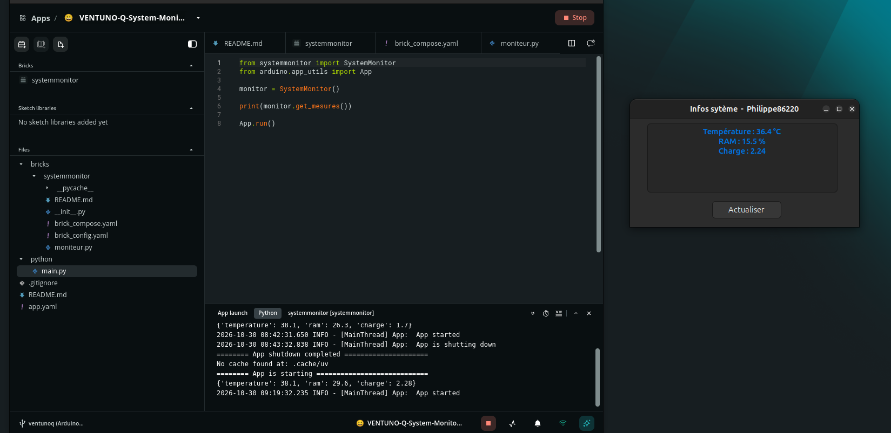

# VENTUNO Q — System Monitor Custom Brick

A custom Arduino App Lab brick that runs a Python HTTP server inside a Docker container on the **Arduino VENTUNO Q**.

The server provides CPU temperature, RAM usage, and system load through a JSON API.

The measurements can be retrieved by:

- The main Arduino App Lab Python application.
- A native Gambas 3 graphical application running directly on Ubuntu.

**No MCU or RouterBridge communication is required.** This project runs entirely on the Linux MPU.

## Screenshot

The screenshot below shows Arduino App Lab running the custom
System Monitor brick alongside the native Gambas 3 application.

The Gambas GUI retrieves CPU temperature, RAM usage, and system
load from the Python HTTP server running inside a Docker container.



## 1. Project Objectives

This project builds on an earlier experiment in which a native Gambas application communicated with a Python HTTP server running directly on Ubuntu.

The objective of this second experiment is to move the Python server into a Docker container managed by Arduino App Lab.

The project explores:

- Custom bricks in Arduino App Lab.
- Docker containers and their relationship with the Linux host.
- Access to Linux system information from containers.
- HTTP communication between Docker services.
- Docker port publishing.
- JSON data exchange.
- Communication between a native Gambas GUI and a containerized Python service.

**Tested environment:**

| Component | Environment |
|---|---|
| Board | Arduino VENTUNO Q |
| Operating system | Ubuntu 24.04 LTS |
| Arduino App Lab | 0.11.0 |
| Docker image | `python:3.12-alpine` |
| Container HTTP port | `9000` |
| Published host port | `8001` |
| Desktop GUI | Gambas 3 |

## 2. Architecture

The system provides two independent communication paths.

```text
                  Arduino VENTUNO Q
                  Linux MPU — Ubuntu
                           |
             +-------------+-------------+
             |                           |
      Arduino App Lab               Gambas 3 GUI
             |                           |
        python/main.py              HTTP request
             |                           |
       SystemMonitor()             127.0.0.1:8001
             |                           |
       __init__.py                  Docker port
             |                       publishing
             |                           |
     http://systemmonitor:9000           |
             |                           |
             +-------------+-------------+
                           |
                           v
                 Docker container
                  systemmonitor
                           |
                     moniteur.py
                           |
                 HTTP server :9000
                           |
                           v
                    Linux system
                           |
             +-------------+-------------+
             |             |             |
         CPU sensors     RAM usage    System load
```

The same HTTP server responds to requests from both clients.

## 3. Project Structure

```text
VENTUNO-Q-System-Monitor-Brick/
|
+-- app.yaml
|
+-- python/
|   +-- main.py
|
+-- bricks/
|   +-- systemmonitor/
|       +-- __init__.py
|       +-- brick_config.yaml
|       +-- brick_compose.yaml
|       +-- moniteur.py
|       +-- README.md
|
+-- README.md
```

### File responsibilities

| File | Responsibility |
|---|---|
| `app.yaml` | Arduino App Lab application configuration |
| `python/main.py` | Main application entry point |
| `bricks/systemmonitor/__init__.py` | Python interface to the custom brick |
| `brick_config.yaml` | Brick configuration |
| `brick_compose.yaml` | Additional Docker service definition |
| `moniteur.py` | HTTP server providing system measurements |

The separation between `__init__.py` and `moniteur.py` is important.

The first acts as a **client interface**, while the second implements the **HTTP server**.

They run in different containers and communicate over the Docker network.

## 4. Docker Configuration

The custom service is declared in:

`bricks/systemmonitor/brick_compose.yaml`

```yaml
services:
  systemmonitor:
    image: python:3.12-alpine

    volumes:
      - ../../../bricks/systemmonitor:/systemmonitor:ro

    command: python3 /systemmonitor/moniteur.py

    ports:
      - "127.0.0.1:8001:9000"
```

### Docker image

```yaml
image: python:3.12-alpine
```

The Alpine-based Python image was selected because the application uses only Python's standard library.

No additional Python packages or system utilities are required.

This avoids installing packages every time the service starts.

### Volume

```yaml
volumes:
  - ../../../bricks/systemmonitor:/systemmonitor:ro
```

This makes the brick's source directory available inside the container.

The `:ro` suffix means **read-only**.

The container can read the source files but cannot modify them through this mount.

### Command

```yaml
command: python3 /systemmonitor/moniteur.py
```

Docker starts the Python HTTP server when the service launches.

## 5. Understanding Docker Port Publishing

One of the most important concepts demonstrated by this project is the following configuration:

```yaml
ports:
  - "127.0.0.1:8001:9000"
```

Docker Compose uses this syntax:

```text
HOST_ADDRESS:HOST_PORT:CONTAINER_PORT
```

In our project:

| Element | Meaning |
|---|---|
| `127.0.0.1` | Host loopback address |
| `8001` | Published port on Ubuntu |
| `9000` | Listening port inside the Docker container |

The two port numbers belong to **different network environments**.

### Example

Gambas sends a request to:

```text
http://127.0.0.1:8001/mesures
```

Docker forwards that connection to port `9000` of the `systemmonitor` container.

```text
Gambas
   |
   | HTTP GET /mesures
   v
127.0.0.1:8001
   |
   | Docker port publishing
   v
systemmonitor container
   |
   v
Port 9000
   |
   v
Python HTTP server
```

The host and container ports do not need to have identical numbers.

For example:

```yaml
ports:
  - "127.0.0.1:8001:9000"
```

is valid even though the ports are different.

This distinction makes the communication architecture easier to understand.

### Why specify 127.0.0.1?

The address `127.0.0.1` is the loopback address of the Ubuntu host.

Binding the published port to this address restricts normal access to applications running on the host.

This is appropriate for our local Gambas application.

Without this restriction, Docker may publish the port on all host network interfaces, potentially making the service accessible from other computers.

## 6. Why Python Listens on 0.0.0.0

Inside `moniteur.py`, the HTTP server is created with:

```python
serveur = HTTPServer(("0.0.0.0", 9000), Serveur)
```

This configuration deserves special attention.

### 127.0.0.1 inside a container

Each container normally has its own network namespace.

Therefore:

```text
127.0.0.1 inside Docker
```

refers to the container itself, **not the Ubuntu host**.

If our Python server listened only on:

```python
HTTPServer(("127.0.0.1", 9000), Serveur)
```

it would accept connections only through the container's loopback interface.

Requests forwarded by Docker to the container's network interface would not reach that listener.

### 0.0.0.0 inside a container

Using:

```python
HTTPServer(("0.0.0.0", 9000), Serveur)
```

instructs Python to listen on all available IPv4 interfaces inside the container.

This includes the interface connected to the Docker network.

**Important:** `0.0.0.0` is a listening address, not the destination address Gambas should use.

### Summary

```text
Python server inside Docker:
    0.0.0.0:9000

Published Docker port on Ubuntu:
    127.0.0.1:8001

Gambas client:
    http://127.0.0.1:8001/mesures
```

These configurations are complementary, not contradictory.

## 7. Python HTTP Server

The file `moniteur.py` uses Python's standard library.

Its principal responsibilities are:

1. Read CPU temperatures.
2. Read memory information.
3. Retrieve the system load average.
4. Return the results as JSON.

The HTTP endpoint is:

```text
GET /mesures
```

Example response:

```json
{
  "temperature": 36.4,
  "ram": 33.0,
  "charge": 1.44
}
```

The values are examples; actual measurements vary continuously.

### CPU temperature

CPU temperatures are read from:

```text
/sys/class/thermal/
```

The program selects thermal zones whose type begins with:

```text
cpu-
```

The highest available CPU sensor value is used.

Thermal values are generally expressed in millidegrees Celsius.

For example:

```text
36400
```

corresponds to:

```text
36.4 °C
```

### RAM usage

Memory information is obtained from:

```text
/proc/meminfo
```

The calculation uses:

```text
RAM usage (%) =
    (MemTotal - MemAvailable) / MemTotal × 100
```

This represents memory usage according to the values exposed by the Linux kernel.

### System load

The load average is retrieved using:

```python
os.getloadavg()
```

This function returns three values corresponding to the average system load over:

- 1 minute.
- 5 minutes.
- 15 minutes.

Our application displays the one-minute value.

**System load is not the same as CPU utilization percentage.**

## 8. How Containers Access Linux System Information

Initially, we expected Docker's isolation to prevent direct access to information about the MPU.

However, our experiments showed that several Linux kernel interfaces remain visible inside ordinary Docker containers.

### Docker containers share the host kernel

Unlike a conventional virtual machine, a Docker container does not run a separate Linux kernel.

Containers share the host kernel while using Linux isolation mechanisms.

Two particularly important mechanisms are:

**Namespaces**

Namespaces isolate selected resources, such as:

- Process identifiers.
- Network interfaces.
- Mount points.

**Control groups (cgroups)**

Cgroups provide resource accounting and controls, including CPU and memory limits.

However, neither mechanism automatically hides every piece of information exposed by the Linux kernel.

### Thermal sensors

On the VENTUNO Q, we first executed:

```bash
cat /sys/class/thermal/thermal_zone*/type
```

We then executed the same command inside a temporary Ubuntu container:

```bash
docker run --rm ubuntu:24.04 \
  sh -c 'cat /sys/class/thermal/thermal_zone*/type'
```

The same thermal sensor names were visible in both environments.

We subsequently confirmed that the container could read CPU temperature values.

Observed temperatures during the experiment ranged from approximately:

```text
35.8 °C to 37.5 °C
```

These results confirmed that the tested Docker configuration exposed the required thermal information without an additional mount.

### Memory information

We also executed:

```bash
docker run --rm ubuntu:24.04 \
  sh -c 'cat /proc/meminfo'
```

The container successfully read the system memory information.

The reported total was:

```text
MemTotal: 15651812 kB
```

This corresponds to approximately 14.93 GiB.

An important distinction remains:

- `/proc/meminfo` can expose host-wide memory information.
- Cgroups provide accounting and possible limits for individual containers.

Our project intentionally monitors the MPU as a whole rather than the memory consumption of the monitoring container.

### System load

We tested the following command:

```bash
docker run --rm python:3.12-alpine \
  python3 -c "import os; print(os.getloadavg())"
```

The command returned:

```text
(1.39794921875, 1.3466796875, 1.35986328125)
```

This confirmed that `os.getloadavg()` worked inside the Alpine-based Python container.

### Conclusion

Docker isolation is selective rather than absolute.

The visibility of system information depends on kernel interfaces, container configuration, mount permissions, namespaces, and other security controls.

The results documented here apply to the tested VENTUNO Q environment and should not be interpreted as a guarantee for every Docker configuration.

## 9. The Custom Brick Python Interface

The file:

`bricks/systemmonitor/__init__.py`

provides a Python class that communicates with the monitoring service.

```python
import json
from urllib.request import urlopen
from urllib.error import URLError, HTTPError


class SystemMonitor:

    def __init__(self, host="http://systemmonitor:9000"):
        self.host = host

    def get_mesures(self):
        try:
            with urlopen(
                self.host + "/mesures",
                timeout=5
            ) as response:
                return json.loads(
                    response.read().decode("utf-8")
                )

        except HTTPError as e:
            return {
                "ok": False,
                "error": f"HTTP {e.code}"
            }

        except URLError as e:
            return {
                "ok": False,
                "error": str(e)
            }
```

### Why use systemmonitor instead of 127.0.0.1?

The address:

```text
http://systemmonitor:9000
```

uses Docker's internal service-name resolution.

The service name `systemmonitor` is defined in `brick_compose.yaml`.

Containers attached to the same Docker network can communicate using these service names.

This is different from the address used by Gambas.

| Client | Server address |
|---|---|
| App Lab Python application | `http://systemmonitor:9000` |
| Native Gambas application | `http://127.0.0.1:8001` |

Both addresses ultimately reach the same Python HTTP server.

## 10. Main Arduino App Lab Application

The main application imports the custom brick:

```python
from systemmonitor import SystemMonitor
from arduino.app_utils import App

monitor = SystemMonitor()

print(monitor.get_mesures())

App.run()
```

The line:

```python
monitor = SystemMonitor()
```

creates an instance of our custom brick interface.

The call:

```python
monitor.get_mesures()
```

sends an HTTP request to the containerized monitoring service.

The response is decoded from JSON into a Python dictionary.

**Startup consideration:** the example makes its HTTP request immediately. If the monitoring service is not ready, the request can fail. A more robust implementation could include retries or a readiness check.

## 11. Communication with Gambas 3

The Gambas application uses an HTTP client to retrieve the measurements.

The essential configuration is:

```gambas
client = New HttpClient

client.URL = "http://127.0.0.1:8001/mesures"
client.Async = False
client.Timeout = 10

client.Get()
```

The returned JSON contains:

```json
{
  "temperature": 36.4,
  "ram": 33.0,
  "charge": 1.44
}
```

Gambas decodes the JSON and displays the measurements in a native graphical interface.

The application includes an **Update** button to retrieve fresh values.

This communication does not pass through the App Lab main application.

Gambas communicates directly with the HTTP service through Docker's published port.

## 12. Testing and Verification

The following tests were successfully performed on the VENTUNO Q.

### Test 1 — Thermal sensor visibility

The thermal zones were visible from both Ubuntu and a temporary Docker container.

**Result:** successful.

### Test 2 — Thermal sensor readings

The container could read the CPU sensor temperatures.

**Result:** successful.

### Test 3 — Memory information

The container could read `/proc/meminfo`.

**Result:** successful.

### Test 4 — System load

Python running in an Alpine container successfully returned the load averages.

**Result:** successful.

### Test 5 — HTTP service

The custom brick's Docker logs included:

```text
172.20.0.3 - - [29/Oct/2026 14:53:56] "GET /mesures HTTP/1.1" 200 -
```

The HTTP status code `200` confirms that the request was handled successfully.

### Test 6 — Gambas graphical application

The Gambas GUI successfully retrieved and displayed the measurements using:

```text
http://127.0.0.1:8001/mesures
```

Observed values included:

```text
Temperature: 36.4 °C
RAM:         33 %
Load:        1.44
```

**Result: successful end-to-end communication between Gambas and the Docker service.**

## 13. Useful Commands

### Inspect active containers

```bash
docker ps
```

### Read monitoring service logs

```bash
docker logs ventuno-q-system-monitor-brick-systemmonitor-1
```

The container name may vary depending on the App Lab project name.

### Test the published HTTP endpoint

```bash
curl http://127.0.0.1:8001/mesures
```

### Inspect available Docker images

```bash
docker images
```

### Run a temporary container

```bash
docker run --rm python:3.12-alpine \
  python3 -c "import os; print(os.getloadavg())"
```

The `--rm` option removes the temporary container when its command finishes.

It does not remove the downloaded Docker image.

## 14. Possible Improvements

Potential future developments include:

- Periodic automatic updates in Gambas.
- Historical measurements and graphical charts.
- Additional CPU and memory metrics.
- Monitoring of the GPU temperature.
- More detailed error handling.
- Service readiness checks.
- Resource usage comparison between the host and individual containers.

These are possible extensions, not features claimed to be implemented in the current version.

## 15. Conclusion

This project demonstrates that a custom Arduino App Lab brick can run a Python HTTP server inside a Docker container and expose Linux MPU measurements to external applications.

It also demonstrates two complementary communication mechanisms:

**Internal Docker communication:**

```text
main.py
   |
   v
SystemMonitor class
   |
   v
http://systemmonitor:9000
```

**Communication from a native Ubuntu application:**

```text
Gambas
   |
   v
http://127.0.0.1:8001
   |
   v
Docker container, port 9000
```

The experiment provides a practical introduction to Docker networking, Linux kernel interfaces, and custom Arduino App Lab services.

The project operates entirely on the VENTUNO Q Linux MPU, without involving the MCU.

## Acknowledgements

Developed and tested on Arduino VENTUNO Q by **philippe86220**, with technical assistance from **ChatGPT (OpenAI)**.
